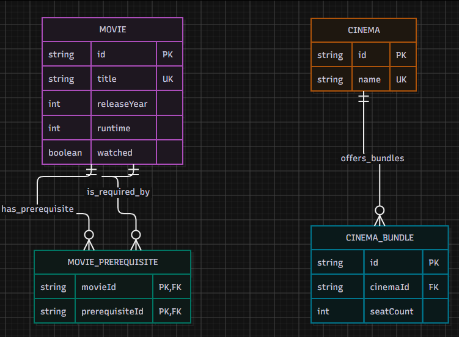
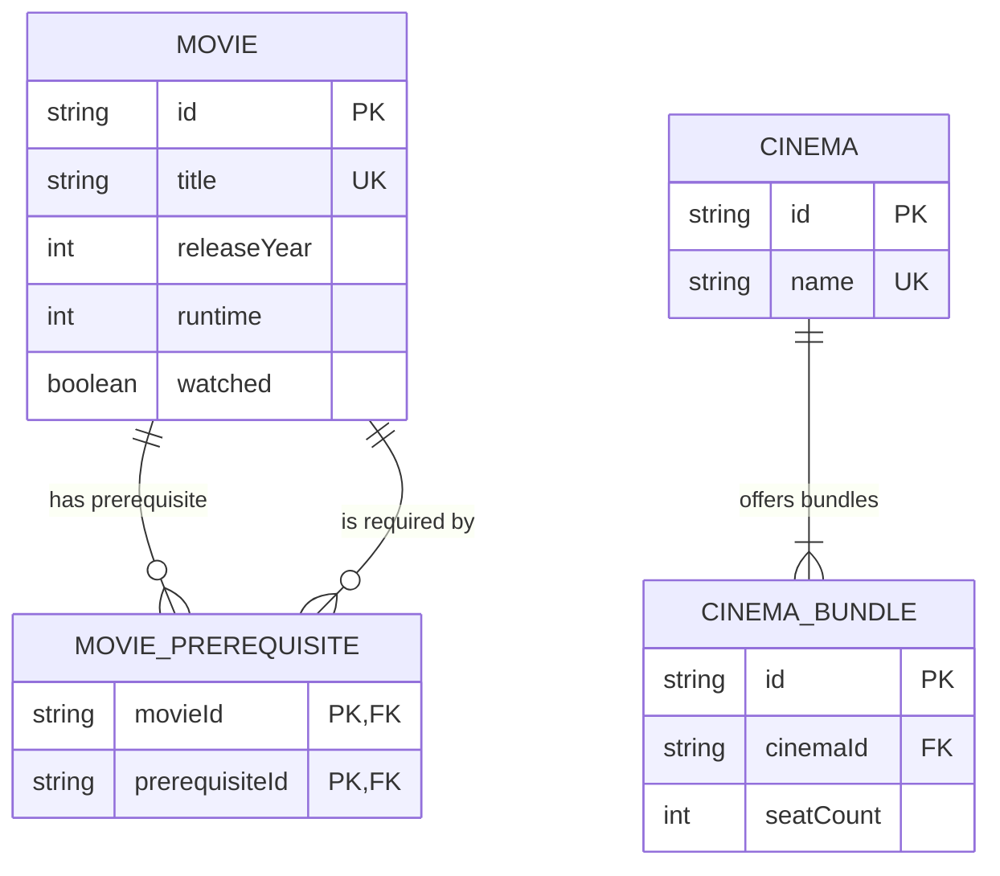

# Doomsday Ready – MCU Rewatch Planner & Cinema Booking

This is **Doomsday Ready**, a full-stack web application I built for Marvel fans who want to prepare for *Avengers: Doomsday*.

MCU movies have connected storylines, so watching them in the right order is important. Also, cinemas offer different seat bundles for opening night, which can make it difficult for a watch party to find the exact number of seats without paying for empty seats.

I built this project as part of the **Blinto Talent Accelerator 2027 – Full-Stack Developer Internship Assessment**.
## Data Model Diagram

The following diagram shows how movies, movie prerequisites, cinemas, and cinema bundles are connected in the database:



<details>
<summary>Click to view Mermaid schema code</summary>


</details>

## What the App Does

### 1. Movie Management & Dependency Tracking
- View, search, and filter MCU movies.
- Add new movies and update existing movie details.
- Set movie title, release year, and runtime (1–300 minutes).
- Choose which movies must be watched before another movie.
- Mark movies as watched or unwatched.
- Prevent a movie from depending on itself, directly or indirectly.
- Return a `409 CIRCULAR_DEPENDENCY` error if a circular dependency is detected.

### 2. MCU Rewatch Plan
- Select a target movie, such as *Avengers: Doomsday*.
- Automatically find all movies that need to be watched first.
- Include nested prerequisites in the rewatch plan.
- Arrange movies in the correct order.
- Keep the target movie out of the prerequisite list.
- Track watching progress, such as "3 of 7 watched".
- Calculate the remaining watch time.

### 3. Cinema Ticket Bundle Calculator
- Select a cinema and enter your group size (1–10,000 people).
- Calculate the minimum number of bundles needed.
- Find an exact seat combination whenever possible, so there are no empty seats.
- Show the number of each bundle required.
- Display `"Not possible"` if an exact combination cannot be found.

**Example:** For a group of 44 people with bundle sizes 6, 9, and 20, the calculator selects:
- 1 × 20-seat bundle
- 2 × 9-seat bundles
- 1 × 6-seat bundle  
*Total: 44 seats using 4 bundles.*

### 4. Interactive Dashboard
The dashboard provides a quick overview of:
- Total movies in the library.
- Number of watched movies.
- Remaining watch time.
- Available cinema venues.
- Quick access to the rewatch plan and ticket calculator.

## Core Algorithms

As required by the assignment rules, I implemented the main algorithms myself without using external graph or optimization libraries.

### 1. Cycle Detection (`wouldCreateCycle`)
This function uses Breadth-First Search (BFS) / DFS to check whether adding a new movie dependency will create a circular relationship.

It starts from the proposed prerequisites and checks whether there is a path back to the movie being updated. If a path exists, the new dependency is rejected.
- **Time Complexity:** $O(V + E)$
- **Space Complexity:** $O(V)$

### 2. Topological Sorting (`getRewatchPlan`)
This function uses **Kahn's Algorithm** to arrange movies in the correct watching order.

It calculates the in-degree of each movie and starts with movies that have no remaining prerequisites. It then processes the movies one by one and updates the in-degree of dependent movies.

This ensures that every prerequisite appears before the movie that depends on it.
- **Time Complexity:** $O(V + E)$
- **Space Complexity:** $O(V)$

### 3. Fewest Bundles Optimization (`calculateFewestBundles`)
This function uses **Dynamic Programming** with the **Unbounded Coin Change** approach to find the minimum number of bundles needed for an exact group size.

A Greedy approach does not always give the best result. For example, with bundle sizes `[1, 3, 4]` and a group size of `6`, Greedy may choose `4 + 1 + 1` (3 bundles), while Dynamic Programming finds `3 + 3` (2 bundles).

I also used a parent array to track and rebuild the selected bundle combination.
- **Time Complexity:** $O(G \times B)$
- **Space Complexity:** $O(G)$

**Complexity Variables:**
- $V$ = Number of movies (vertices).
- $E$ = Number of movie dependencies (edges).
- $G$ = Requested group size.
- $B$ = Number of available bundle types.
## Tech Stack

- **Backend:** Node.js, Express.js, TypeScript
- **Database & ORM:** SQLite, Prisma ORM
- **Validation & Security:** Zod, Helmet, CORS, Express Rate Limit
- **Frontend:** React, TypeScript, Vite, Tailwind CSS, Lucide Icons
- **Testing & Deployment:** Vitest, Docker, Docker Compose

## How to Run the Project

### Option 1: Run with Docker Compose
Make sure Docker is installed and running.

Clone the repository:
```bash
git clone https://github.com/Abubakrkazi/doomsday_ready.git
cd doomsday_ready
```

Start the application:
```bash
docker compose up --build
```

After starting:
- **Frontend:** `http://localhost:5173`
- **Backend API:** `http://localhost:5000/api`
### Option 2: Run Locally

#### Step 1: Start the Backend
Open a terminal and run:
```bash
cd backend
npm install
npx prisma migrate dev --name init
npx prisma db seed
npm run dev
```
The backend runs on port 5000. The seed script preloads sample MCU movies and cinema data.

#### Step 2: Start the Frontend
Open another terminal:
```bash
cd frontend
npm install
npm run dev
```
Open `http://localhost:5173` in your browser.

## Running Unit Tests

I used **Vitest** to test the main algorithms and assignment requirements.

Run the tests with:
```bash
cd backend
npm test
```

The project includes 9 automated test cases covering:
- *Thor: Ragnarok* returns an empty prerequisite list.
- *Civil War* returns *Iron Man* and *Captain America: The First Avenger*, followed by *The Avengers*.
- *Doomsday* returns all 7 required movies in a valid order.
- Direct self-dependency and circular dependencies are detected.
- Bundle calculation for group sizes 6, 11, and 44.
- An impossible group size of 7 with bundle sizes 4 and 6.

**Test Status:** All 9 test cases pass.

## AI Usage Disclosure

In line with the assignment guidelines:
- I used AI tools, including Google Antigravity and ChatGPT, during development.
- They helped me with the initial project setup, Prisma configuration, and ideas for test cases.
- I wrote, reviewed, and tested the main algorithm logic manually to make sure no third-party libraries were used.

